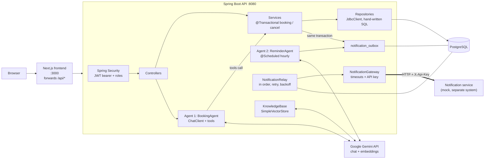

# MockPrep

**Book mock interviews and resume reviews with experienced engineers, or just ask the AI agent to do it.**

MockPrep is a full-stack scheduling platform for software engineers preparing for interviews. Customers book
coding, system-design and behavioral mock interviews with mentors; mentors publish their availability. On top of a
transactional booking core it runs **two AI agents and a retrieval-augmented help desk**, built with
**Spring AI + Google Gemini**.

Built for SJSU CMPE 172 (Enterprise Software Platforms), Fall 2026, in four milestones.

**Stack:** Java 21 · Spring Boot 3.5 · Spring Security (JWT) · Spring AI 1.1 + Gemini · PostgreSQL 16 (plain JDBC,
hand-written SQL) · Next.js 16 + React 19 + TypeScript · Docker Compose · GitHub Actions · Testcontainers

## AI and agentic features

| Feature | What it does | Code |
|---|---|---|
| **Conversational booking agent** (Agent 1, reactive) | Chat in plain English: *"find the earliest mock coding interview this week and book it"*. Gemini calls tools in several steps (check availability → propose booking → summarize), asks for confirmation, handles a slot that is taken by offering alternatives, and remembers the conversation. | `ai/agent/BookingAgent`, `BookingAgentTools` |
| **Guarded writes** | Every tool wraps an existing service-layer method. Book and cancel go through the same `@Transactional` services as the REST API, so the double-booking guard, owner-only cancel and RBAC still apply. Tools are bound to the logged-in user (no user-id parameter), so the model cannot act as anyone else. | `BookingAgentTools.book/cancel` |
| **Confirm-before-write, enforced in code** | `proposeBooking` only stores a server-side pending action. `confirmPendingAction` refuses to run in the same turn as the proposal, so the user must have replied "yes" first, whatever the model decides. | `PendingAction`, `AgentSessions` |
| **Autonomous reminder agent** (Agent 2, proactive) | An hourly `@Scheduled` job that nobody prompts. It finds sessions starting within 24 h, retrieves preparation tips for the session type, has Gemini write a personalized reminder, and sends it through the notification service. An admin can also run it on demand. | `ai/reminder/ReminderAgent` |
| **Grounded Q&A (RAG)** | Policy/FAQ questions are answered only from MockPrep's handbook. The handbook is split into sections, embedded with Gemini embeddings, stored in a `SimpleVectorStore`, retrieved by similarity and passed to the model as context. Answers list their sources. | `ai/knowledge/KnowledgeBase`, `PolicyQaService`, [`knowledge/mockprep-handbook.md`](src/main/resources/knowledge/mockprep-handbook.md) |
| **Bonus: persistent conversation memory** | Chat history is stored in PostgreSQL through Spring AI's `JdbcChatMemoryRepository`, so a conversation survives a restart. Each conversation id is prefixed with the user id, so users can only load their own. | `schema.sql` (`spring_ai_chat_memory`), `BookingAgent.history` |

Without a `GEMINI_API_KEY` the app still runs normally. The AI endpoints answer `503 "AI is not configured"`, and
the tests use stand-in models, so CI never calls the real API.

## Milestones

| | What was built | Report | Code walkthrough |
|---|---|---|---|
| **M1** Foundations | Layered Spring Boot skeleton, PostgreSQL schema with a double-booking guard, ER and block diagrams, wireframes, Docker, CI | [PDF](docs/CMPE172_Milestone1_Report.pdf) | [video](https://drive.google.com/file/d/1bjLsSmwjBthYJkkrbdtsvMnHgxPHTZpi/view?usp=sharing) |
| **M2** Booking core | Login + role-based access, browse/book/cancel, provider slots, optimistic locking with a retry loop, concurrency test (two threads, one slot) | [PDF](docs/CMPE172_Milestone2_Report.pdf) | [video](https://drive.google.com/file/d/10eYO288ZeQLtlxiJdYc3K5R9Ii3TWqV-/view?usp=sharing) |
| **M3** Distribution & operations | Notification service boundary (gateway, timeout, retry, fallback, idempotency), `/health`, metrics, logging, Docker health check, CI | [PDF](docs/CMPE172_Milestone3_Report.pdf) | [video](https://drive.google.com/file/d/1OmLJ7df6l5PLxmGjS5zRz7_moh1DLNOu/view?usp=sharing) |
| **M4** Enterprise AI | Two Gemini agents, RAG Q&A, JWT auth, Next.js frontend, transactional outbox (fixes the two M3 review findings), mock-service API key | [PDF](docs/CMPE172_Milestone4_Report.pdf) | [video](https://youtu.be/mxX4EAlQFxE) |

## Architecture



**Layers:** Controller → Service → Repository (JDBC) → PostgreSQL. Controllers return DTOs, never rows. Agents are
another client of the service layer, not a shortcut around it.

Design docs: [architecture](docs/architecture-diagram.png) · [agent turn sequence](docs/agent-sequence.png) · [notification boundary + outbox](docs/distribution-diagram.png) ·
[ER diagram](docs/er-diagram.png) · [relational schema](docs/relational-schema.md) ·
[booking sequence](docs/booking-sequence.png) · [block diagram](docs/block-diagram.png) ·
[wireframes](docs/wireframes.pdf) (Mermaid sources next to each PNG)

## Quick start (Docker)

```bash
cp .env.example .env          # set DB_PASSWORD; add GEMINI_API_KEY for the AI features
docker compose up --build     # web http://localhost:3000, API http://localhost:8080
```

Seeded accounts (password `password123`): customers `sam.dev`, `jordan.dev`; mentors `alice.mentor`,
`raj.mentor`, `maria.mentor`; admin `admin`. Data persists in the `pgdata` volume; `docker compose down -v`
resets it (seed slots are created relative to the day the database is first seeded).

### Local development

```bash
docker compose up -d db
export $(grep -v '^#' .env | xargs)
mvn spring-boot:run                       # API on :8080
cd frontend && npm install && npm run dev # web on :3000 (forwards /api to :8080)
```

Prerequisites: JDK 21, Maven 3.9+, Node 20.9+, Docker.

### Configuration (`.env`, never committed)

| Variable | Purpose | If blank |
|---|---|---|
| `DB_PASSWORD` (`DB_USERNAME`, `DB_URL`) | PostgreSQL | required |
| `GEMINI_API_KEY` | Google AI Studio key. Only the API key is used (Gemini Developer API), never a Cloud project-id/location | AI features answer 503 |
| `GEMINI_MODEL` | Chat model, default `gemini-3.5-flash-lite` | default |
| `GEMINI_FALLBACK_MODEL` | Models tried in order when the primary fails, default `gemini-3.1-flash-lite,gemini-3.8-flash` | default |
| `JWT_SECRET` | HS256 signing key, base64, 32+ bytes (`openssl rand -base64 32`) | random per start |
| `NOTIFICATION_API_KEY` | Shared key between the scheduler and the notification service | random per start |

**Model choice.** `gemini-3.8-flash` is the newest Flash model on the Gemini API, but on 2026-11-17 it answered most
requests with `503 high demand` (free tier). `gemini-3.5-flash-lite` answered every call in about a second and handles
tool calling well, so it is the default; set `GEMINI_MODEL=gemini-3.8-flash` to use the newest model.
Gemini is treated like any external service: 20 s timeout per call, 2 attempts, then fallback models
(`FallbackChatModel`), with a 60 s circuit breaker that skips a failing primary.

## How the AI agents work

**Agent 1 tools** (`BookingAgentTools`, one instance per request, bound to the logged-in customer):

| Tool | Wraps | Writes? |
|---|---|---|
| `listServicesAndMentors` | `CatalogService` | no |
| `checkAvailability(fromDate, toDate, serviceId?, mentorId?)` | `SlotService.findOpenSlots` (SQL `LIMIT/OFFSET`) | no |
| `listMyAppointments(scope)` | `AppointmentService.listForCustomer` | no |
| `searchPolicies(question)` | `KnowledgeBase.search` (vector similarity) | no |
| `proposeBooking(slotId, notes)` / `proposeCancellation(appointmentId)` | `SlotService.findOpenSlot` / own upcoming list | stores a pending action only |
| `confirmPendingAction()` | `BookingService.book` / `AppointmentService.cancel` | **yes**, only in a later turn |
| `discardPendingAction()` | n/a | no |

One chat turn: Spring AI sends the system prompt (rules, today's date, the user), the stored conversation, the new
message and the tool definitions to Gemini. Gemini answers or requests tool calls; Spring AI executes them and
returns the results, looping until Gemini produces the final text. If a confirmed booking loses a race, the
transactional service throws `SlotUnavailableException` and the tool returns three alternatives instead.

**Agent 2** (`ReminderAgent`): scan → retrieve tips (RAG) → LLM writes the reminder → in one transaction, claim the
appointment (`reminder_sent_at`) and insert the message into the notification outbox → the relay delivers it. An LLM
failure leaves the appointment unclaimed, so the next run retries it. Manual trigger:
`POST /api/admin/agents/reminders/run` (ADMIN), or **Run now** on the Admin page.

**RAG:** `KnowledgeBase` splits the handbook at its `##` headings (one chunk per section), embeds the chunks with
`gemini-embedding-2` at startup, and keeps them in Spring AI's in-memory `SimpleVectorStore`. `PolicyQaService` uses
`QuestionAnswerAdvisor` (top 4 chunks above a similarity threshold) and a system prompt that allows answers only from
that context.

## Reliability: notifications (Milestone 3, revised in Milestone 4)

- **Transactional outbox:** booking, cancelling and the reminder agent insert their notification into
  `notification_outbox` *inside the same transaction* as the change. A crash after the commit cannot lose it.
  A rolled-back booking attempt leaves no notification.
- **Relay:** `NotificationRelay` sends rows in write order. It runs right after each commit (`AFTER_COMMIT`
  event, background thread) and polls every 5 s as a safety net, for example after a restart. If a row cannot be
  sent, later rows for the same appointment wait behind it, so a "cancelled" never arrives before its "confirmed".
- **Timeout / retry / fallback:** connect 1 s, read 2 s; 3 tries per burst with 200/400 ms backoff; then the row stays
  `PENDING` with `next_attempt_at` 30 s later; `FAILED` after 10 attempts or on a 4xx.
- **Idempotency:** key `appointment-{id}-{TYPE}` (unique in the outbox, sent as `Idempotency-Key`). The service
  stores each key once, so a retry after a lost answer does not notify twice.
- **Protected service:** every `/mock-notify/**` request (send, read messages, admin mode switch) needs the
  `X-Api-Key` header, or it gets 401. The key is compared in constant time.

## Security

- **JWT:** `POST /api/auth/login` checks the BCrypt hash and returns an HS256-signed token (`sub`, `uid`, `roles`,
  2 h expiry). Every request sends `Authorization: Bearer <token>`; Spring's OAuth2 resource server verifies it. The
  user and role are re-read from the database on each request. There is no server session and no auth cookie, so
  CSRF protection is not needed.
- **RBAC:** `/api/customer/**` CUSTOMER, `/api/provider/**` PROVIDER, `/api/admin/**` ADMIN, `/api/assistant/chat`
  CUSTOMER, `/api/assistant/ask` any logged-in user. No or invalid token → 401, wrong role → 403. Services check
  ownership again (defense in depth).
- **AI rate limit:** 10 AI requests per user per minute (429 after that), so one account cannot use up the shared
  Gemini quota for everyone.
- **Operations data:** `/actuator/metrics` is ADMIN-only; only `/health` and `/actuator/health` are public; other
  actuator endpoints (env, configprops) are not exposed.
- **CORS:** only the origins in `CORS_ORIGINS` (default `http://localhost:3000`).
- **Secrets:** only in `.env` / environment variables; nothing secret is committed.

## API

| Method | Path | Who | Description |
|---|---|---|---|
| POST | `/api/auth/login` | anyone | `{"username","password"}` → `{token, tokenType, expiresAt, user}` or 401 |
| GET | `/api/auth/me` | anyone | Current user, or 204 |
| GET | `/api/home`, `/api/services`, `/api/providers` | anyone | Catalog |
| GET | `/api/slots?providerId&serviceId&date&page&size` | anyone | Open future slots, paginated |
| GET | `/api/slots/{id}` | anyone | One open slot |
| POST | `/api/customer/appointments` | CUSTOMER | Book `{"slotId","serviceId","notes"}` → 201, or **409** if taken |
| GET | `/api/customer/appointments?scope=upcoming\|history` | CUSTOMER | My appointments |
| POST | `/api/customer/appointments/{id}/cancel` | CUSTOMER (owner) | Cancel; the slot reopens |
| GET / POST | `/api/provider/slots` | PROVIDER | My slots / add one `{"serviceId","startTime"}` |
| DELETE | `/api/provider/slots/{id}` | PROVIDER (owner) | Remove an open slot |
| GET | `/api/provider/appointments?scope=` | PROVIDER | Booked with me |
| POST | `/api/assistant/chat` | CUSTOMER | `{"conversationId","message"}` → `{reply, pendingAction, actionsTaken}` |
| GET / DELETE | `/api/assistant/chat/{conversationId}` | CUSTOMER | Stored conversation / forget it |
| POST | `/api/assistant/ask` | logged in | `{"question"}` → `{answer, sources}` (RAG) |
| POST | `/api/admin/agents/reminders/run` | ADMIN | Run the autonomous agent now |
| GET | `/api/admin/notifications` | ADMIN | Latest outbox rows |
| GET | `/health` | anyone | Database + notification status (503 if the database is down) |
| GET | `/actuator/metrics/{scheduler.booking\|scheduler.notifications\|scheduler.ai.reminders}` | ADMIN | Metrics |

Example:
```bash
TOKEN=$(curl -s -X POST localhost:8080/api/auth/login -H 'Content-Type: application/json' \
  -d '{"username":"sam.dev","password":"password123"}' | jq -r .token)
curl -s localhost:8080/api/customer/appointments -H "Authorization: Bearer $TOKEN"
curl -s -X POST localhost:8080/api/assistant/chat -H "Authorization: Bearer $TOKEN" -H 'Content-Type: application/json' \
  -d '{"conversationId":"demo-0001","message":"Find the earliest mock coding interview this week"}'
```

## Concurrency (double-booking prevention)

1. `SlotBooker.bookOnce` runs in one `@Transactional(READ_COMMITTED)` transaction and claims the slot with an
   optimistic version check: `UPDATE availability_slots SET status='BOOKED', version=version+1 WHERE id=? AND
   version=? AND status='OPEN'`. 0 rows updated means someone else won.
2. `BookingService` retries a lost race up to 3 times, each in a new transaction; the retry sees BOOKED → 409.
3. Database backstop: `UNIQUE INDEX uq_appt_active_slot ON appointments (slot_id) WHERE status='BOOKED'`.

## Tests

`mvn -B verify` runs 145 tests against a real PostgreSQL (Testcontainers). Without Docker:
`mvn test -Dspring.profiles.active=localdb` against a throwaway local database.

| Test | Covers |
|---|---|
| `AgentBookingToolsTest` | **The agent's book tool goes through the transactional path:** a slot taken while the user reads the summary → refused with alternatives, still exactly one booking; a slot taken before the user confirms leaves no stale Confirm offer; two agents confirming the same slot at once → exactly one wins (5 rounds); a double-clicked Confirm books once; no write in the proposing turn; cannot cancel another user's appointment |
| `AiFeaturesIntegrationTest` | Reminder agent (LLM prompt contains the appointment and the RAG tips, queued once, scheduled + manual run at the same time → one reminder, appointment cancelled while the LLM writes → nothing sent, LLM failure retried later, stored in the outbox during an outage), admin-only trigger, RAG answer with sources, chat memory persisted per user, per-user AI rate limit |
| `SecurityExposureTest` | The M3 "public endpoint" finding applied to the whole API: 17 endpoints reject anonymous callers, a 9-case role matrix returns 403, metrics/env not public, expired / foreign-key / forged tokens rejected, role changes and deleted accounts take effect immediately, no cross-customer data, no stack traces |
| `FallbackChatModelTest` | Gemini overloaded → fallback models in order; circuit breaker skips the failing primary |
| `ConcurrentBookingTest` | Two threads book one slot; exactly one succeeds |
| `NotificationIntegrationTest` | Real HTTP to the mock: one message per book/cancel, **in order after an outage**, **delivered after a simulated crash**, timeout without duplicate, **mock rejects calls without the API key** |
| `NotificationDownIntegrationTest` | Booking/cancel succeed with the service down; `/health` DEGRADED |
| `NotificationRelayTest`, `NotificationSenderTest` | Ordering, backoff, give-up rules (unit) |
| `AuthIntegrationTest` | JWT login, forged token → 401, 401 vs 403 per role, no session cookie, CORS, AI 503 without key |
| `BookingFlowIntegrationTest`, `ApiIntegrationTest` | Book, 409, cancel, provider slots, browse/filter/paginate over HTTP |
| `BookingServiceTest`, `AppointmentServiceTest`, `ProviderSlotServiceTest`, `SlotServiceTest` | Service rules (unit) |

CI ([Actions](https://github.com/c-banh-mi/MockPrep/actions)) runs the backend tests, builds the
frontend (TypeScript strict) and builds both Docker images on every push.

## Known limitations

- The vector store is in memory: the handbook is re-embedded on every start (a few seconds, 17 embedding
  calls). Chroma/pgvector would persist it.
- A pending (unconfirmed) agent action is held in memory for 15 minutes; after a restart the user just asks again.
- Logout is client-side: a JWT stays valid until it expires (2 h). A deny-list or short-lived tokens with refresh
  would close this.
- The JWT is kept in `sessionStorage`, which an XSS bug could read. An HttpOnly cookie would be safer but brings CSRF
  back.
- One relay at a time per JVM keeps notifications in order; with several app instances, a database advisory lock
  would be needed.
- The notification service is a mock that stores messages in memory; no real email is sent.
- Gemini free-tier capacity varies: when every configured model is overloaded, AI endpoints answer 503 (the rest of
  the app is unaffected) and the reminder agent retries in the next run. A 30-60 s answer is possible while the
  primary model is timing out.
- The AI rate limit is per JVM, in memory.

## Repository layout

```
src/main/java/edu/sjsu/cmpe172/scheduler/
  controller/  service/  repository/  model/  dto/  exception/   layered core
  security/      JWT issue/verify, RBAC
  notification/  outbox, relay, sender, gateway       mocknotify/  the mock notification service
  ai/agent/      Agent 1 (tools, sessions)            ai/reminder/ Agent 2
  ai/knowledge/  RAG knowledge base + Q&A
src/main/resources/  schema.sql, seed.sql, application.yml, knowledge/mockprep-handbook.md
frontend/            Next.js app (app/ pages, lib/api.ts, lib/auth.tsx)
docs/                reports, diagrams, schema notes, wireframes
```

Design decisions per milestone: [`DECISIONS.md`](DECISIONS.md).
